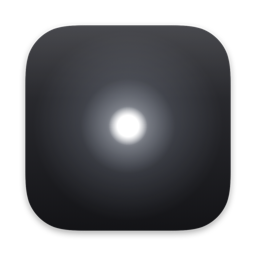
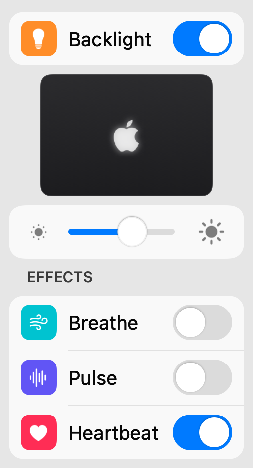

<p align="center">
  
</p>

<h1 align="center">LogoLight</h1>

<p align="center">
  The illuminated logo on the back of your MacBook Pro, your way:<br>
  turn it off, dim it, or let it breathe, pulse or beat like a heart. Right from the menu bar.
</p>

<p align="center">
  <a href="https://logolight.app"><b>Download at logolight.app</b></a>
  &nbsp;·&nbsp; Free &nbsp;·&nbsp; Open source (MIT)
  &nbsp;·&nbsp; <a href="https://buymeacoffee.com/arkon">Buy me a coffee</a>
</p>

<p align="center">
  <picture>
    <source media="(prefers-color-scheme: dark)" srcset="docs/menu-dark.png">
    
  </picture>
</p>

For the **MacBook Pro with PROLED XDR Display**, the model with the illuminated logo on its lid.

## Features

- **Backlight switch** at the top of the menu, or **Option-click** the menu bar icon to toggle.
  The logo fades out and in smoothly, and no password is needed
- A **live view** of your lid, in its own finish (space black or silver), read from the hardware
  on every frame of the display while the menu is open, so it follows effects, the slider and
  changes made elsewhere
- **Brightness** slider. The logo still adapts to ambient light, scaled by the slider
- **Effects**: Breathe, Pulse and Heartbeat, one at a time, using the LED's own hardware fades.
  They peak at the chosen brightness
- **Control Center**: a Backlight control, which can also go in the menu bar (macOS 26 or later)
- **Launch at Login**
- Without direct control, a password is needed **once at most** (see
  [the fallback](#fallback-the-documented-command))

## Install

1. Download LogoLight from [logolight.app](https://logolight.app). It's signed with a Developer
   ID and notarized by Apple.
2. Unzip it, move **LogoLight** to your Applications folder and open it. It lives in the menu bar.

Or [build it from source](#build-from-source).

### Add it to Control Center

1. Click Control Center in the menu bar, then **Edit Controls** at the bottom.
2. Search for **LogoLight**.
3. Drag **Backlight** into Control Center, or straight into the menu bar.

Apple only lets apps add switches and buttons to Control Center, so the brightness slider stays
in LogoLight's own menu.

## How it works

Apple documents a single setting for the logo in
[About the illuminated Apple logo](https://support.apple.com/en-us/149248):

```sh
sudo defaults write com.apple.CoreBrightness LEBacklightMode -int 0   # turn off
sudo defaults delete com.apple.CoreBrightness LEBacklightMode         # turn back on
```

The logo is driven by `corebrightnessd`, which watches that setting. While the logo is on,
it sets the brightness automatically from the screen brightness and ambient light. The
setting applies to every user account, and also in macOS Recovery.

### Direct control (no password)

`corebrightnessd`'s light emitter ("LE") module also accepts a few keys from any app through
CoreBrightness's `BrightnessSystemClient`, the interface Control Center uses for brightness:

| Key | What it does |
| --- | --- |
| `LEBacklightMode` | `0` off, `2` on. `corebrightnessd` (running as root) saves it to the same `LEBacklightMode` default as the command above, so it persists, and `defaults delete` still turns the logo back on. |
| `LEPWMFactorFadeDuration` | How long the logo's fade takes, in seconds. `0` restores the automatic duration. |
| `DisplayLogicalState` | `1` (Blank) fades the logo out and `2` (Unblank) fades it back in. The screen is unaffected, but the keyboard backlight follows it too (see below). |
| `LEPWMState` | Live state, e.g. `Factor` (fade position), `FinalNits`, `Lux` (read only). |

LogoLight uses these to switch the logo without a password and to fade it smoothly:
turning off fades out over a second first, and turning on starts from dark and fades in
(with an effect chosen, the effect's first rise is the fade in). The effects are loops of
the same fades. They pause when the logo is off, the display sleeps, or the built-in display
goes away (lid closed with an external display).

The keyboard backlight also listens to `DisplayLogicalState`, so right after every Blank,
LogoLight tells the keyboard alone that the display is still on, which keeps it lit. When the
display really sleeps, the keyboard goes dark as usual.

There's no key for the logo's brightness, so the slider stops a fade part way: LogoLight
watches `Factor`, and near the level it eases the logo on with a few short fades, so it slows
to a stop instead of halting at speed. Then it starts a fade the other way that's so slow it
never visibly moves. The level lasts until the next change. While the slider is dragged, the
running fade follows it rather than starting again at every step. Quitting LogoLight returns
the logo to normal brightness.

This is private API, found by inspecting CoreBrightness (the details, measurements and
the tools used are in [docs/corebrightnessd.md](docs/corebrightnessd.md) and
[tools/probes](tools/probes)). LogoLight loads it dynamically and,
if it's missing or `corebrightnessd` doesn't take a change, falls back to running Apple's
documented command as root (see below). Brightness and effects need direct control, and are
hidden without it.

### The Control Center control

The control is a WidgetKit extension inside the app (`Controls/`). Extensions must be sandboxed,
so it can't reach `corebrightnessd` itself, and only the app may change the logo anyway, since
the app also holds the brightness and plays effects. The app serves a Mach port named after its
bundle ID (`app.logolight.LogoLight.control`), and the extension is allowed to look up just that
name. A tap asks the app to flip its switch, as Option-click does; if LogoLight isn't running, it's
opened in the background first. The app reloads the control whenever its switch changes. (Apple
only lets apps add switches and buttons to Control Center, so there's no brightness slider
there.)

### Reading the state

The setting is read from `corebrightnessd` (`LEBacklightMode`). The logo's `bklb-backlight` PWM
device in the I/O Registry shows whether the LED is lit, and how brightly:

```sh
ioreg -r -n bklb-backlight@0 | grep -E '"(enabled|high-period|low-period)"'
```

`high-period / (high-period + low-period)` is the LED's current output level. (The menu doesn't
show it: the live view uses the fade level instead, which is on the slider's scale.) Without
direct control, LogoLight reads the setting from `enabled` while the screen is on. It doesn't
rely on the `bklb-backlight-enabled` NVRAM variable, which `corebrightnessd` only reads at
startup and which isn't updated as soon as the setting changes.

### Fallback: the documented command

If direct control isn't available, LogoLight runs the documented command as root, which
needs your password in the standard macOS administrator dialog. You only enter it once: the
first time, the dialog says it will also turn on **Disable Password** (a menu item that's only
shown in this case, or if it's already on), and together with the change it installs this
sudoers rule to `/etc/sudoers.d/logolight`:

```
lee ALL = (root) NOPASSWD: /usr/bin/defaults write com.apple.CoreBrightness LEBacklightMode -int 0, /usr/bin/defaults delete com.apple.CoreBrightness LEBacklightMode
```

It allows only those two exact commands, for your user only. The rule is checked with
`visudo` before it's installed (owned by root, mode `0440`), so a bad rule can't break
`sudo`. After that, the logo switches without a password. If the rule can't be installed, or
`sudo` doesn't honor it, the dialog comes back as before, and stops offering the rule while
LogoLight is running.

Uncheck **Disable Password** to remove the rule and be asked every time. LogoLight remembers
that and doesn't install the rule again until you check the item again. (Deleting the file
yourself, `sudo rm /etc/sudoers.d/logolight`, also removes it, but then the next password
installs it again.)

## Requirements

- A MacBook Pro with PROLED XDR Display (on other Macs the menu says the logo isn't available)
- macOS 14 or later to build and run (the PROLED models ship with macOS 27); the Control
  Center control needs macOS 26
- Xcode or the Command Line Tools (`xcode-select --install`). Without Xcode 26 or later, the
  app is built without the Control Center control (it needs Xcode's App Intents tools)

## Build from source

```sh
make test      # run the tests
make app       # build build/LogoLight.app
make install   # copy it to /Applications and open it
```

`make run` builds and opens the app from `build/` without installing it.

The app is ad-hoc signed, with the hardened runtime. To sign it with your Developer ID,
notarize it and zip it for distribution:

```sh
xcrun notarytool store-credentials logolight --apple-id YOU@EXAMPLE.COM --team-id TEAMID   # once
SIGN_IDENTITY="Developer ID Application: Your Name (TEAMID)" NOTARY_PROFILE=logolight make dist
```

Other overrides for `scripts/build-app.sh`: `VERSION`, `BUILD_NUMBER`, `BUNDLE_ID`.

LogoLight can't go on the Mac App Store: it uses private API, and the App Store requires the
App Sandbox, which rules out both direct control and the admin-command fallback.

## Uninstall

1. If **Disable Password** is checked, uncheck it first (this removes the sudoers rule).
2. Turn off **Launch at Login** if you turned it on.
3. Quit LogoLight and delete it from Applications (`make uninstall`).

The logo setting itself stays as you left it (an effect stops when the app quits). To turn
the logo back on without the app:
`sudo defaults delete com.apple.CoreBrightness LEBacklightMode`.

## Project layout

| Path | What's there |
| --- | --- |
| `Sources/LogoLightCore` | `LogoController`; direct control, brightness and effects (`LightEmitter`, `LogoEffect`); reading the state (I/O Registry); the documented command, the admin dialog and the sudoers rule; what the menu shows (`PanelState`) |
| `Sources/LogoLight` | The AppKit menu bar app, including the control panel (`ControlPanel.swift`) |
| `Sources/LogoLightTests` | The test suite (`swift run LogoLightTests`) |
| `Controls` | The Control Center control, an extension built by `scripts/build-app.sh` |
| `Resources/Info.plist` | App bundle metadata (template) |
| `scripts/build-app.sh` | Builds and signs `LogoLight.app` |
| `scripts/notarize.sh` | Notarizes, staples and zips a Developer ID build (`make dist`) |
| `docs/corebrightnessd.md` | Research notes: the keys, the fade curve, holding a level |
| `tools/probes` | The command-line tools used for that research |
| `tools/livecheck` | Checks brightness and effects against the real logo |
| `CLAUDE.md` | Notes for picking up work on the project |

The tests are a plain executable instead of an XCTest bundle, because XCTest and
swift-testing only ship with a full Xcode install. They cover the exact commands,
shell and AppleScript quoting, the sudoers rule (checked with the real `visudo`), the
controller and effects against a simulated Mac and a fake `corebrightnessd` that logs
every key it's sent and moves its fades along the measured curve, and a read-only check of
this Mac's real logo state.

## Support

LogoLight is free. If you like it, you can [buy me a coffee](https://buymeacoffee.com/arkon).

## License

MIT (see [LICENSE](LICENSE)). The signed, notarized app is free at
[logolight.app](https://logolight.app).

---

LogoLight is not affiliated with or endorsed by Apple Inc.
