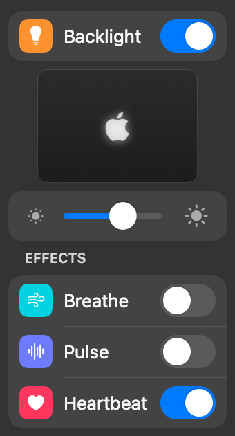

# LogoLight

A small macOS menu bar app that controls the illuminated Apple logo on the back of the
**MacBook Pro with PROLED XDR Display**: on and off, brightness, and glowing effects.



- An iOS-style panel at the top of the menu. Everything below the logo switch greys out while
  the logo is off
- A **live view** of the logo, read from the hardware 30 times a second while the menu is open,
  so it follows effects, the slider and changes made elsewhere
- **Backlight** switch, or **Option-click** the icon to toggle. The logo fades out and in
  smoothly, and no password is needed
- **Brightness** slider. The logo still adapts to ambient light, scaled by the slider
- **Effects**: Breathe, Pulse and Heartbeat, one at a time, using the LED's own hardware fades.
  They peak at the chosen brightness
- **Launch at Login**
- No Xcode needed to build: just the Command Line Tools

## How it works

Apple documents a single setting for the logo in
[About the illuminated Apple logo](https://support.apple.com/en-us/149248):

```sh
sudo defaults write com.apple.CoreBrightness LEBacklightMode -int 0   # turn off
sudo defaults delete com.apple.CoreBrightness LEBacklightMode         # turn back on
```

The logo is driven by `corebrightnessd`, which watches that setting. While the logo is on,
it sets the brightness automatically from the screen brightness and ambient light. The
setting applies to every user account, and also in macOS Recovery.

### Direct control (no password)

`corebrightnessd`'s light emitter ("LE") module also accepts a few keys from any app through
CoreBrightness's `BrightnessSystemClient`, the interface Control Center uses for brightness:

| Key | What it does |
| --- | --- |
| `LEBacklightMode` | `0` off, `2` on. `corebrightnessd` (running as root) saves it to the same `LEBacklightMode` default as the command above, so it persists, and `defaults delete` still turns the logo back on. |
| `LEPWMFactorFadeDuration` | How long the logo's fade takes, in seconds. `0` restores the automatic duration. |
| `DisplayLogicalState` | `1` (Blank) fades the logo out and `2` (Unblank) fades it back in. The screen is unaffected, but the keyboard backlight follows it too (see below). |
| `LEPWMState` | Live state, e.g. `Factor` (fade position), `FinalNits`, `Lux` (read only). |

LogoLight uses these to switch the logo without a password and to fade it smoothly:
turning off fades out over a second first, and turning on starts from dark and fades in
(with an effect chosen, the effect's first rise is the fade in). The effects are loops of
the same fades. They pause when the logo is off, the display sleeps, or the built-in display
goes away (lid closed with an external display).

The keyboard backlight also listens to `DisplayLogicalState`, so right after every Blank,
LogoLight tells the keyboard alone that the display is still on, which keeps it lit. When the
display really sleeps, the keyboard goes dark as usual.

There's no key for the logo's brightness, so the slider stops a fade part way: LogoLight
watches `Factor` until it reaches the level, then starts a fade the other way that's so slow
it never visibly moves. The level lasts until the next change. While the slider is dragged,
the running fade follows it rather than starting again at every step. Quitting LogoLight
returns the logo to normal brightness.

This is private API, found by inspecting CoreBrightness (the details, measurements and
the tools used are in [docs/corebrightnessd.md](docs/corebrightnessd.md) and
[tools/probes](tools/probes)). LogoLight loads it dynamically and,
if it's missing or `corebrightnessd` doesn't take a change, falls back to running Apple's
documented command as root (see below). Brightness and effects need direct control, and are
hidden without it.

### Reading the state

The setting is read from `corebrightnessd` (`LEBacklightMode`). The menu's output level comes
from the logo's `bklb-backlight` PWM device in the I/O Registry:

```sh
ioreg -r -n bklb-backlight@0 | grep -E '"(enabled|high-period|low-period)"'
```

`high-period / (high-period + low-period)` is the LED's current output level. Without
direct control, LogoLight reads the setting from `enabled` while the screen is on. It doesn't
rely on the `bklb-backlight-enabled` NVRAM variable, which `corebrightnessd` only reads at
startup and which isn't updated as soon as the setting changes.

### Fallback: the documented command

If direct control isn't available, LogoLight runs the documented command as root, asking
for your password with the standard macOS administrator dialog each time. To avoid that, turn
on **Toggle Without Password** (only shown in this case, or if it's already on). LogoLight
explains what it's about to do and then, after you enter your password once, installs this
sudoers rule to `/etc/sudoers.d/logolight`:

```
lee ALL = (root) NOPASSWD: /usr/bin/defaults write com.apple.CoreBrightness LEBacklightMode -int 0, /usr/bin/defaults delete com.apple.CoreBrightness LEBacklightMode
```

It allows only those two exact commands, for your user only. The rule is checked with
`visudo` before it's installed (owned by root, mode `0440`), so a bad rule can't break
`sudo`. Turn the option off to remove it, or delete the file yourself:
`sudo rm /etc/sudoers.d/logolight`.

## Requirements

- A MacBook Pro with PROLED XDR Display (on other Macs the menu says the logo isn't available)
- macOS 14 or later to build and run (the PROLED models ship with macOS 27)
- Xcode or the Command Line Tools (`xcode-select --install`)

## Build and install

```sh
make test      # run the tests
make app       # build build/LogoLight.app
make install   # copy it to /Applications and open it
```

`make run` builds and opens the app from `build/` without installing it.

The app is ad-hoc signed, with the hardened runtime. To sign it with your Developer ID,
notarize it and zip it for distribution:

```sh
xcrun notarytool store-credentials logolight --apple-id YOU@EXAMPLE.COM --team-id TEAMID   # once
SIGN_IDENTITY="Developer ID Application: Your Name (TEAMID)" NOTARY_PROFILE=logolight make dist
```

Other overrides for `scripts/build-app.sh`: `VERSION`, `BUILD_NUMBER`, `BUNDLE_ID`.

LogoLight can't go on the Mac App Store: it uses private API, and the App Store requires the
App Sandbox, which rules out both direct control and the admin-command fallback.

## Uninstall

1. If you turned on **Toggle Without Password**, turn it off first (this removes the sudoers rule).
2. Turn off **Launch at Login** if you turned it on.
3. Quit LogoLight and delete it from Applications (`make uninstall`).

The logo setting itself stays as you left it (an effect stops when the app quits). To turn
the logo back on without the app:
`sudo defaults delete com.apple.CoreBrightness LEBacklightMode`.

## Project layout

| Path | What's there |
| --- | --- |
| `Sources/LogoLightCore` | `LogoController`; direct control, brightness and effects (`LightEmitter`, `LogoEffect`); reading the state (I/O Registry); the documented command, the admin dialog and the sudoers rule; what the menu shows (`PanelState`) |
| `Sources/LogoLight` | The AppKit menu bar app, including the control panel (`ControlPanel.swift`) |
| `Sources/LogoLightTests` | The test suite (`swift run LogoLightTests`) |
| `Resources/Info.plist` | App bundle metadata (template) |
| `scripts/build-app.sh` | Builds and signs `LogoLight.app` |
| `scripts/notarize.sh` | Notarizes, staples and zips a Developer ID build (`make dist`) |
| `docs/corebrightnessd.md` | Research notes: the keys, the fade curve, holding a level |
| `tools/probes` | The command-line tools used for that research |
| `tools/livecheck` | Checks brightness and effects against the real logo |
| `CLAUDE.md` | Notes for picking up work on the project |

The tests are a plain executable instead of an XCTest bundle, because XCTest and
swift-testing only ship with a full Xcode install. They cover the exact commands,
shell and AppleScript quoting, the sudoers rule (checked with the real `visudo`), the
controller and effects against a simulated Mac and a fake `corebrightnessd` that logs
every key it's sent and moves its fades along the measured curve, and a read-only check of
this Mac's real logo state.

---

LogoLight is not affiliated with or endorsed by Apple Inc.
